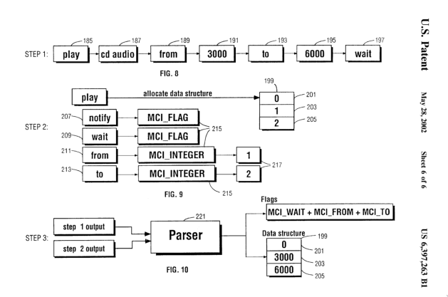

MCI (Media Control Interface) is an old Windows API for controlling media devices with high-level command strings like `play file.wav from 0 to 100`. The general shape is:

```bash
command <device> [parameters ...]
```

There is no fixed list of commands. Instead, a command table defines each command and its arguments, and the parser reads it, so new commands can be added by just editing the table. Here's part of the `open` entry in [ScummVM's in-memory command table](https://github.com/scummvm/scummvm/blob/master/engines/director/lingo/lingo-mci.cpp):

```cpp
static CmdTableRow table[] = {
  {"open"            ,MCI_OPEN      ,0          ,MCI_COMMAND_HEAD },
  {""                ,MCI_INTEGER   ,0          ,MCI_RETURN }      ,
  {"notify"          ,0x00000001L   ,-1         ,MCI_FLAG }        ,
  {"wait"            ,0x00000002L   ,-1         ,MCI_FLAG }        ,
  {"type"            ,0x00002000L   ,-1         ,MCI_STRING }      ,
  {"element"         ,0x00000200L   ,-1         ,MCI_STRING }      ,
  {"alias"           ,0x00000400L   ,-1         ,MCI_STRING }      ,
  {"shareable"       ,0x00000100L   ,-1         ,MCI_FLAG }        ,
  {""                ,0x00000000L   ,-1         ,MCI_END_COMMAND } ,
  // ...
```

IBM [patented](https://patents.google.com/patent/US6397263) this parsing mechanism. The patent goes as far as specifying that tokens are kept in a linked list rather than an array, probably for low-memory devices, and that the parsed arguments end up in a byte array at fixed offsets.

[Wine's MCI parser](https://github.com/wine-mirror/wine/blob/9e99c6f66d236101a084b6a3a24c98b5c8677fe5/dlls/winmm/mci.c) does the same thing: it parses the command strings a Win32 program sends and translates them into calls to Linux sound and video APIs. ScummVM does the same with its own APIs, but stores each command's arguments in a hash table instead of a byte array.


