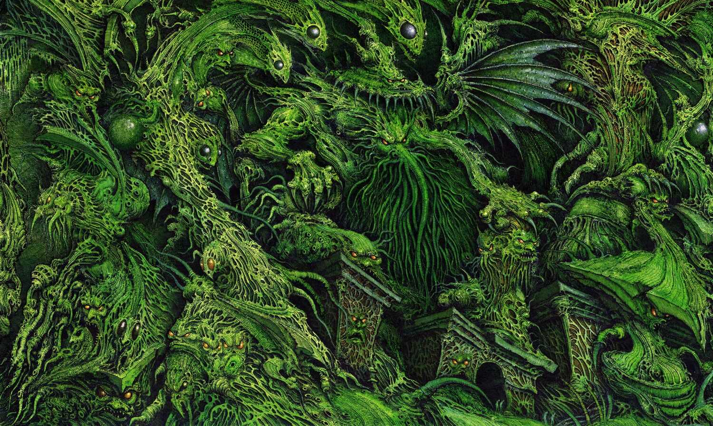

Downloaded images tend to have useless names:

```bash
$ ls
1672714705640839.png 1689964585834142.png 2.jpg
```

[`ollama`](https://ollama.com) with the `moondream` vision model is small enough to run quickly on a laptop. This asks it for a title for every `.jpg` in the current directory and turns each title into a plausible filename:

```bash
find . -name "*.jpg" |
xargs -I{} ollama run moondream "Title for this: {}" |
tr ' ' '_' | sed 's/$/\.jpg/'
```

Some of the (slightly truncated) results:
`A_green_dragon_with_wings_and_a_tail.jpg` {: width="20px"},
`A_painting_of_a_serene_landscape.jpg` {: width="20px"},
`urns_of_stone_red_car_in_foreground.jpg` {: width="20px"}.

